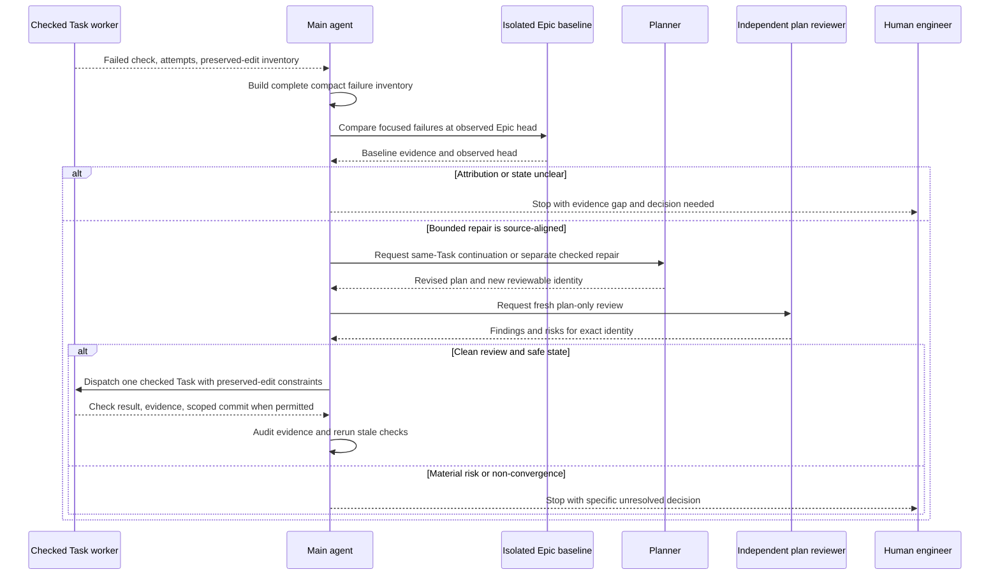

# Improve AFK Story Execution and Recovery — Software Design

## Inputs and scope

This design implements `docs/features/afk-story-execution-and-recovery/brd.md`, especially REQ-01–REQ-08. It follows `docs/architecture.md` and the selected `.agents/skills/command-pattern/SKILL.md`. The feature changes Sibu's prompt-owned development pipeline guidance and distributed templates, not the CLI runtime or a new deep module. It has no UI impact.

The active Story branch remains the sole place for recovery edits, including a bounded repair for a bug already present at the observed Epic/base head. No recovery edit is made directly to the Epic branch. The existing Story PR integrates those checked edits before later Stories start.

## Ownership and boundaries

- **AI-Augmented Development Pipeline / Skill Guidance:** the main-agent executor guidance owns failure diagnosis, recovery selection, review/dispatch gates, PR handoff, and human stops. Planner guidance owns changed-plan instructions and Task ordering; checked-Task executor guidance owns only its assigned Task and permitted scoped commit. These are prompt contracts, not new runtime handlers.
- **Template Catalog:** distributes changed skill guidance with a versioned manifest and user-facing sync notes. Installed customized copies remain project-owned and are not silently overwritten.
- **Existing Story artifacts:** the reviewed Story plan carries Task outcome, check, expected evidence, and ordering. The existing non-Markdown progress log carries compact failure, attribution, repair, review, and check outcomes. Avoid a second recovery ledger or a new approval status.
- **External boundaries:** Git provides local branch, head, index, and worktree facts. GitHub provides PR, required-check, branch-policy, and merge facts through configured MCP when capable, with narrow read-only host fallback when not. Sibu does not own those policies or infer them from a submitted request.

The selected command-pattern guidance applies to any executable runtime operation, but this feature adds none. Do not fabricate a Command/Handler/Port layer for skill text; if later implementation reveals a genuinely new runtime operation, return to the SAD before designing it here.

## Blocked-check diagnosis and recovery flow

1. **Record the failure before choosing a fix.** On aggregate-check failure, collect a complete but compact inventory: check identity and observed head, each failing case or assertion, likely-cause group, affected Task, expected contract, owning paths, and evidence locator. A truncated log or count cannot stand in for an inventory. Obtain focused read-only detail when needed; if the complete set cannot be established, mark it incomplete and stop attribution. This covers BRD REQ-01.
2. **Compare with a stable baseline.** Record the current Story and Epic/base heads. Reproduce focused failures at the observed Epic head in isolation from the active Story's uncommitted edits; do not stash, reset, or overwrite them. Classify evidence as active-Story regression, pre-existing failure, host/test-runner failure, or unresolved. Recheck heads before acting if either can have moved. Classification must include uncertainty and the evidence that supports it. This covers REQ-02.
3. **Choose only a bounded recovery route.** A clear pre-existing failure with safe ownership may be repaired as a checked prerequisite on the active Story branch. If the smallest repair overlaps the blocked Task's uncommitted paths, revise and continue that same Task; keep its Task ID, goal, prescribed check, expected evidence, dependencies, prior attempts, and one-commit authority. This applies whether the bug was pre-existing or introduced by the Story. For a clear path-disjoint same-Story regression attributable to an earlier committed Task, add an ordered follow-up checked Task before the blocked Task resumes. Preserve the blocked edits unstaged and out of the follow-up commit. A path-disjoint pre-existing prerequisite may likewise be a separate reviewed checked Task. This covers REQ-03 and REQ-04.
4. **Review before dispatch.** The planner makes the smallest source-aligned change to the reviewable Story plan. The main agent establishes the new plan identity and obtains fresh independent plan-only review. Clean review permits AFK continuation under the existing acceptance rule; new material findings, unsupported ownership, unclear attribution, or no substantive progress stop for the engineer. Recheck plan identity, Story branch, index, worktree, and preserved-edit inventory before each executor dispatch. No executor self-approves a plan or takes PR authority. This covers REQ-06.
5. **Revalidate and close the Task honestly.** A repaired Task must satisfy its original goal and prescribed check with every `Done when` evidence item. Rerun checks made stale by a repair, including relevant previously passing final checks. A path-disjoint follow-up receives its own passing scoped commit before the blocked Task resumes; an overlapping continuation retains the blocked Task's single eventual commit. A failed or unavailable required check remains a blocker. This covers REQ-05.

The existing worker's limited in-context fix attempts remain the first response to an ordinary check failure. Reviewed recovery begins after that bounded attempt or a post-commit evidence audit; it is not an unlimited retry reset. Host/test-runner failure is reported separately and is not permission for speculative source changes. No route weakens checks or broadens accepted Story scope silently.

The diagram shows the decision and ownership flow, not parallel worker execution. In the path-disjoint case, the dispatched worker handles the follow-up first and the blocked Task resumes in a later fresh context.

## Story and Epic PR handoff

The main agent verifies Story plan identity, Task commits and `Done when` evidence, Story-level validation, exact PR head/base, branch/index/worktree safety, required host checks, and merge policy before a squash-only Story merge. For host facts and PR effects, try configured GitHub MCP first. If MCP cannot supply a needed read-only fact, disclose the specific capability gap and use the smallest necessary read-only host verification; avoid repeated approval prompts or broad policy queries. Local Git remains the source for local state. A missing, pending, failed, stale, or ambiguous required check or policy fact blocks merge. If an effect might have occurred, read back actual PR and Epic-head state before retrying or continuing. This covers BRD REQ-07 and RULE-05.

At Epic PR handoff, reconcile all merged Story PRs against the observed Epic head, run or observe the named Epic-level check, and present known host check and merge-policy status to the engineer. The Epic PR remains a human review surface, never an automatic Epic merge. Story and Epic PR summaries include compact failure attribution, reviewed repairs, actual checks, residual limits, and any stop without raw private logs or false pass claims. This covers REQ-08 and RULE-06.

Existing executor guidance still mentions deferred human-only QA and a QA merge prerequisite. Delivery work must remove those stale gates and PR fields so they do not contradict the BRD: separate manual or automated behavioral QA is neither planned nor requested by this pipeline. This does **not** remove planned Task or Story checks or the required human Epic PR review.

## Quality strategy and planned verification

The engineer confirmed this verification direction before SDD authoring. It is a plan, not evidence that commands ran or that an agent behaved as instructed.

- **Deterministic guidance checks (REQ-01–REQ-06):** use static contract assertions and disposable fixture scenarios, where applicable, to check that the distributed guidance names the full failure inventory, stable Epic-head comparison, four attribution outcomes, same-Task overlap, path-disjoint follow-up, preserved edits, fresh review, stale-check reruns, and explicit stops. Include edge cases for truncated aggregate output, pre-existing overlapping repair, ambiguous edit ownership, changed heads, and non-convergence. Expected evidence is passing assertions against the exact changed guidance and fixtures; these do not prove live-agent compliance.
- **Handoff checks (REQ-07–REQ-08):** deterministic contract cases should distinguish MCP fact available, MCP capability missing with narrow read-only fallback, unavailable required host fact, and ambiguous possible merge effect. Confirm PR summary fields and no automatic Epic merge. Expected evidence is passing contract assertions and source review of the PR gate wording; no real GitHub PR or merge is part of routine unit checks.
- **Repository/package checks:** after template changes stabilize, run `pnpm verify` for the repository's compiled test/build gate and `pnpm run validate:packed-runtime` because changed skills are distributed package assets. Validate manifest version/update notes and, when practical, the init/doctor/sync lifecycle in a disposable project. Record actual results during implementation rather than claiming them here.
- **Human-owned limit:** the engineer reviews the final Epic PR. Deterministic prompt checks cannot establish that an LLM will follow recovery or host-safety instructions in live runs. Separate manual and automated behavioral QA, including live-agent evals, are outside this feature and are not treated as completed by these checks.

No UI visual review applies. No production deployment or live-model integration eval is prescribed. If implementation finds that the proposed deterministic checks cannot answer an in-scope requirement, surface the gap for an engineer-directed SDD revision rather than substituting a weaker check silently.

## Risks and tradeoffs

- A complete failure inventory may require focused evidence retrieval after truncated output; stopping on incomplete evidence costs AFK time but prevents invented attribution.
- Baseline comparison must be isolated from uncommitted Story edits and tied to an observed head; moving branches or unsafe local state must stop recovery.
- Prompt-owned guidance can be checked for internal consistency, but its live behavior remains nondeterministic without separately scoped evals. The design therefore avoids claims that static tests prove agent conduct.
- MCP capability varies by host and installation. Safe fallback favors accurate read-only facts and a visible stop over a guessed merge decision.

## Diagram validation

The exact sequence block parsed successfully with locally installed Mermaid 11.12.0 (`mermaid.parse`); rendering was not run. Semantic review found the intended order and boundaries: worker reports failure, main agent inventories and compares against an isolated Epic baseline, planner and independent reviewer gate a bounded repair, and the human receives unresolved stops. Parsing does not establish live workflow behavior.
