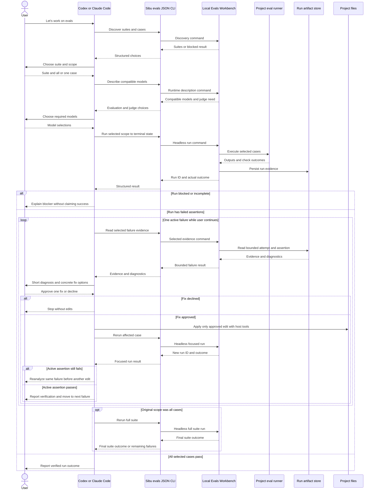

# Agent-Guided Evals Software Design Document

## Inputs and design boundary

This design implements `docs/features/agent-guided-evals/brd.md` within the existing `local-evals-workbench` deep module defined by `docs/architecture.md` and the selected `command-pattern` guidance. There is no Sibu UI change, so no feature UX mockup is required. Codex and Claude Code supply the conversation; Sibu remains the local eval runtime, not a coding agent or editor.

The design uses a mandatory, separately named agent-guided-evals skill alongside the existing mandatory eval-authoring skill. It does not add an agent-specific evaluation engine. The installed skill describes the one-failure-at-a-time conversation and how to use a shared, non-UI Sibu interface; packaging and routing for Codex and Claude Code are Template Catalog responsibilities.

## Architecture and responsibilities

**Local Evals Workbench** owns discovery, runtime/model compatibility, execution, persisted run evidence, and bounded evidence retrieval. Add a headless command-oriented slice for running a selected scope to a terminal outcome, plus thin JSON CLI adapters for the module's discovery, description, run, and evidence operations. `sibu evals` without a subcommand continues to launch the browser workbench. The new CLI path must not depend on the browser or a running local HTTP server. It reuses the current suite format, runner protocol, safety checks, and run-artifact store rather than creating parallel execution or result semantics. This covers `REQ-01`, `REQ-02`, `REQ-07`, `REQ-08`, and `REQ-10` in the source BRD.

The **Template Catalog** distributes the new mandatory skill to selected agents and routes natural requests such as “let's work on evals” to it. The skill prompts for suite, scope, evaluation model, and judge model when needed. It then calls the same Sibu commands in either host, interprets one selected failure's bounded evidence using the host agent's own reasoning, presents a short diagnosis and options, and requests explicit approval of a concrete fix. The host agent's model is distinct from both the Model Under Evaluation and Judge Model. Sibu's existing OpenAI-backed UI analysis and proposal features remain unchanged and are not prerequisites for agent-guided diagnosis. This covers `REQ-03`, `REQ-04`, and `REQ-08`.

**External coding-agent harnesses** own code edits after the user approves a specific proposed fix in the conversation. The new CLI exposes no file-mutation shortcut and does not pass an approval marker on the agent's behalf. The agent must state affected paths and intended change before approval, use its normal host editing permissions, compare actual edits with the approved scope, and report the delta. Sibu's existing UI repair action retains its own approval and file-safety gates. This path relies on agent instructions and host permissions, not a Sibu-enforced conversational approval gate; see the risk and verification sections. This covers `REQ-04`, `REQ-05`, `REQ-06`, and `REQ-09`.

### Command contracts and boundaries

The JSON CLI surface under `sibu evals` exposes four logical operations:

| Operation | Command intent and transport-neutral result | Responsibility |
| --- | --- | --- |
| `suites` | Discover valid suites; return suite IDs, names, case IDs/names, or a typed blocked result. | Adapt the existing discovery operation; do not inspect eval JSON independently in the agent. |
| `describe <suite>` | Describe compatible evaluation and judge models and whether selected checks require a judge; return typed unavailability. | Adapt the existing runtime-description operation. |
| `run <suite>` | Select `all` or one case, evaluation model, and optional judge; wait for a terminal run state; return run ID, actual outcome, and concise case/check status. | A new Local Evals Workbench command/handler coordinates existing selection, runner, and artifact operations through injected ports. It must await completion rather than leave a background task behind when the CLI exits. |
| `result <suite> <run>` | Return a bounded run summary or evidence for one selected case, attempt, and assertion, with diagnostics and artifact references. | Adapt the existing run-history reader; never dump every output or trace into ordinary agent context. |

Each operation has an immutable Command, focused Handler, transport-neutral Result, and slice-owned Ports where needed. CLI entrypoints perform argument parsing and JSON presentation only. Handlers enforce suite/scope/model validity and return typed blocked/error outcomes; adapters own filesystem, process, runner, and provider access. New slices do not import another slice's internals. No new deep module, database, hosted service, or general-purpose agent protocol is introduced. Concrete flag spelling is a CLI-adapter detail; stable JSON fields and outcome meanings are the agent-facing contract.

The headless `run` path must use the same model/judge compatibility, artifact-readiness, runner protocol, and result-persistence checks as the UI path. A queued run that has not reached a terminal state is not a completed eval. If interrupted, return the run ID and persisted state so the agent can explain what happened rather than claim a result. Results distinguish failed assertions from incomplete cases, runner errors, missing credentials, and judge/configuration blocks.

## Main interaction and verification loop

The skill selects the next unresolved assertion in stable suite/case/check order and keeps only that failure active. Before proposing a fix for a later failure, it uses a current focused result for that case; if the only evidence predates an intervening edit, it reruns that case first so it does not repair a stale failure. A focused rerun that passes the active assertion permits moving on; it does not prove the repair is permanently reliable or that other checks are unaffected. If the originally selected scope was the full suite, a final suite run is required before claiming suite success. Failures found there re-enter the same one-at-a-time loop. The skill must not rerun repeatedly merely to obtain a pass, apply a second fix without another user decision, or continue indefinitely when evidence is ambiguous. This implements `REQ-03`, `REQ-05`, `REQ-06`, and `REQ-07`.

The user-approved edit is followed by a fresh case run, not reuse of the original result. Run IDs tie explanations to evidence. The agent reports whether the active assertion passed, whether other checks failed, and whether final suite validation passed. If the user declines, changes scope, or the agent cannot safely distinguish its edits from concurrent changes, it stops with a clear status. The existing UI remains another way to inspect the same suites and run artifacts (`REQ-09`, `REQ-10`).

## Safety, state, and failure behavior

- **Approval and edit scope:** the skill records the proposed fix and named paths in the conversation before asking for approval. It inspects the working-tree baseline before editing, preserves pre-existing changes, and compares the post-edit delta with the approved paths. Unexpected or uncertain changes stop automatic reruns and are reported for human review; no automatic reset or destructive cleanup is attempted. Secret and credential files are never repair targets. Native host permissions still apply.
- **Evidence boundary:** only the active failure's bounded output, assertion/grader result, expected/reference context, and relevant diagnostics enter routine agent analysis. Artifact paths are references, not permission to load an entire run or repository. The existing project-root, symlink, artifact-isolation, and runner side-effect safeguards remain in force.
- **Run states:** blocked, error, interrupted, partial, and missing-artifact states are not assertion failures or successful verification. The agent explains the specific known reason and next action without proposing an unsupported prompt fix. If an edit or run has an uncertain outcome, it stops rather than replaying it blindly.
- **Session state:** the agent conversation tracks selected suite, scope, models, active failure, approved fix, and run IDs; Sibu persists authoritative run evidence as it does today. No separate Sibu session database or automatic cross-conversation resume is required.
- **Operational visibility:** command handlers emit structured, safe run and blocked-outcome events with run IDs, scope, status, reason, and duration where useful. They do not log credentials, full model output, raw evidence, or proposed patch content. CLI JSON results are user-facing operation contracts, not log parsing.

## Quality strategy and planned verification

- **Deterministic unit tests:** test CLI argument-to-Command mapping and JSON Result translation; run orchestration with fake ports; model/judge and scope validation; terminal versus partial/blocked result handling; bounded evidence selection; and the invariant that no mutation operation is exposed by the headless eval CLI. These tests do not claim to prove that an LLM follows the skill.
- **Integration and regression tests:** use disposable repo fixtures and fake/local runners to show the headless and UI paths discover the same suites, persist/read compatible results, preserve the existing `sibu evals` browser launch, and do not need the HTTP server for headless runs. Cover invalid IDs, unavailable models/judges, runner interruption, missing credentials, unsafe artifacts, and concurrent or pre-existing edits.
- **Agent behavior evals:** separately, with disposable projects and explicit authorization to run live models, observe Codex and Claude Code on a failing single case and a multi-failure suite. Check that each asks for models, diagnoses one failure at a time, waits for fix approval, edits only approved paths, reruns automatically, and stops honestly on blockers. Report observed behavior and nondeterministic limits; do not put these evals in the routine unit-test suite.
- **Validation commands planned, not run:** `pnpm run check`, `pnpm run test`, and `pnpm run validate:packed-runtime` after implementation stabilizes. Package-level smoke coverage must ensure the mandatory skill and headless CLI work from the installed package, not only the source checkout.

## Risks and tradeoffs

- **Prompt-governed approval is weaker than a Sibu-enforced mutation gate.** The user chose normal harness edits after explicit conversational approval to avoid a second editing system. The skill, native host permissions, baseline/delta checks, and agent behavior evals mitigate but cannot guarantee correct agent behavior. This limitation must not be represented as a hard enforcement guarantee.
- **Headless execution needs a terminal result.** Reusing a UI-oriented queued scheduler without awaiting its work could strand runs when a short-lived CLI exits; the new slice must coordinate completion and preserve partial/interrupted evidence.
- **AI behavior is nondeterministic.** A passing focused rerun verifies only that run. The final full-suite rerun catches cross-case regressions for suite scope, but does not prove future runs will always pass.
- **Two agent hosts need one contract.** Keep the Sibu JSON operation contract and skill workflow shared; limit host-specific work to discovery/routing and permission presentation rather than forking eval logic.

## Diagram validation

The final sequence block parsed with locally installed Mermaid 11.12.0 (`mermaid.parse`). No visual renderer was run. The diagram was also checked for actor, boundary, ordering, and failure-path consistency; parsing does not prove the agent will follow the workflow or that the feature is implemented.
