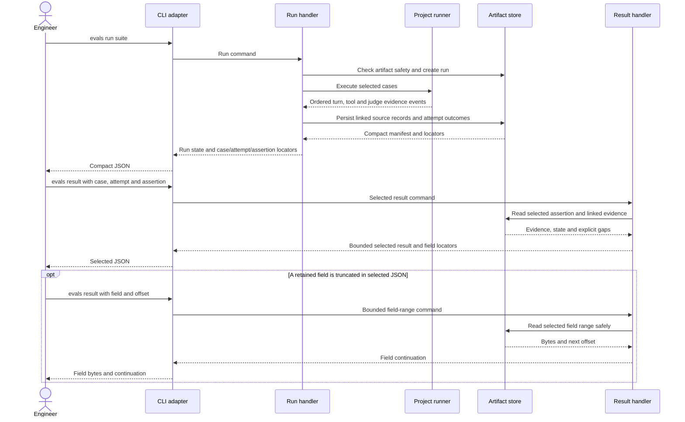

# Eval Failure Evidence Software Design Document

## Inputs and boundary

This design implements `docs/features/eval-failure-evidence/brd.md` (REQ-01–REQ-08, AC-01–AC-06) within the **Local Evals Workbench** deep module defined by `docs/architecture.md`. The selected `command-pattern` guidance applies: the existing run and result commands remain the executable slices; runner, artifact, and CLI details stay in their adapters. No screen or browser interaction changes, so no UX artifact is required.

The current runner protocol records bounded assistant output strings, tool traces, and grader summaries. Attempt artifacts retain those values, but the selected CLI result clips `actual`/`expected`, filters out conversation and tools, and accepts attempt 1 only. Neither the protocol nor the stored attempt captures the exact provider response, actual model-call messages, or exact judge exchange. The change must capture these at execution time; re-reading a suite definition later cannot reconstruct what the model or judge actually saw.

## Design summary

Keep the compact manifest and run JSON as an index. Extend the runner-to-workbench evidence contract and attempt artifact to retain source evidence for each evaluated turn and rubric judgment. The selected result command reads only the requested case/attempt/assertion and projects its causal context; it does not load or print every case's evidence. The normal selected response remains bounded, but every omitted retained field has a field locator and a bounded read continuation. Existing artifacts and older project runners remain readable, with explicit `not-captured` gaps rather than fabricated source evidence.

The selected result is **not** a diagnosis engine. It separates observed outcome and evidence from a possible interpretation. A low score can support “model response did not meet this rubric”; “judge disagreement” remains an inference for an engineer or coding agent comparing the exact judge request and response. Runner/tool errors and incomplete cases carry their own states and may have no failed assertion to select.

## Owning operations and interfaces

| Boundary | Responsibility and decision |
| --- | --- |
| `headless-eval-run` command/handler | Keep model choice, artifact-readiness gate, execution, and compact case/attempt/assertion locators. Do not embed transcripts in run results. Preserve ordered locators beyond the current fixed list limit by explicitly marking partial locator lists and providing a continuation rather than leaving a failed assertion unreachable. Supports REQ-01, REQ-05. |
| Runner process adapter and `run-execution` | Accept a versioned evidence extension from a project runner. Validate event identity, sequence, case, attempt, turn, and check links before persistence. Capture actual model-call messages, raw provider response (text and structured tool calls), normalized output, tool request/result events, approved-fact provenance if supplied, and exact judge request/response. Do not infer them from fixtures. Supports REQ-02–REQ-04. |
| `run-history` artifact store/reader | Persist validated source evidence under the existing ignored `evals/artifacts/` tree, with the manifest remaining a compact index. Keep exact large payloads in bounded, addressable evidence records rather than clipping them into attempt summaries. Verify safe paths, regular files, identity, and artifact limits on every read. Expose a selected assertion plus its linked turn/context and field-range reads through module-owned ports. Supports REQ-02–REQ-07. |
| `headless-eval-result` command/handler | Validate suite/run/case/attempt/assertion selection and project only that failure's evidence. Return exact values that fit, typed gap/truncation markers for those that do not, field locators and continuation offsets, states, actual model IDs, errors, score, and threshold. A field-range request returns only a bounded portion of one retained field. Supports REQ-02–REQ-06. |
| CLI adapter and documentation | Add an explicit attempt selector and evidence-field continuation options to `sibu evals result`; translate result states to stable JSON without deciding failure cause or reading files directly. Document locator → selected result → omitted field retrieval. Supports REQ-01, REQ-06, REQ-08. |

Do not add a new deep module, generic event bus, or independent evidence service. Keep new contracts local to the workbench and expose them through its existing public composition. Existing dashboard behavior remains unchanged.

## Evidence and ordering contract

The runner extension is versioned so an older runner's valid events still work. A capable runner reports **what was actually sent and returned**, not what the test case intended to send:

- For each model call: ordered input messages, including prior conversation and tool results; model ID; turn/call sequence and elapsed or wall-clock markers; the exact raw provider response with text and structured tool calls; and the normalized response used by Sibu. Preserve the distinction between a provider response and a post-tool assistant continuation. Approved facts are identified only when the runner can attest they were included in those inputs.
- For each tool interaction: request name/arguments, response or error, order, and the call/turn link. A fixture's declared mock result is not evidence that the model received it; record the delivered result.
- For each assertion: evaluated check definition/reference value, linked turn(s)/tool(s), outcome, score and threshold where applicable, and diagnostics. For each rubric judgment: actual Judge Model ID, exact judge request (all instructions, evaluated content, and reference context supplied), exact judge response/rationale, and parsed numeric score. Keep parsed values separate from raw judge text.
- For execution: run/case/attempt/check state, start/completion order, duration, and safe error codes. A failed attempt or interrupted run retains all safely captured earlier evidence and marks later expected evidence `not-captured` or `incomplete`.

The validator rejects duplicate IDs, reordered events, cross-attempt links, malformed scores, and claims of complete evidence with missing chunks. A compatibility reader accepts older attempt artifacts but marks absent raw response, input, or judge fields `not-captured`. It must never relabel an old normalized output as raw provider output. If a runner cannot emit the extension, the CLI reports the gap and the runner contract/documentation explains how to gain full evidence in a future run. This is a transition constraint, not a reason to rewrite old artifacts.

## Persistence, limits, and selected reads

Keep attempt summaries and locators small. Persist each source payload as a linked evidence record under the run's safe artifact path; records can be emitted/read in chunks so the existing per-event and attempt-summary limits do not silently cut off large responses. A record has type, case/attempt/turn/check identity, order, byte length, and completion status. Publish a reference from the attempt only after all chunks for that record are validated and written. An interrupted or over-limit capture leaves an explicit `incomplete`/`capture-failed` gap, never a shortened value labeled “raw.” Preserve existing atomic write and Git-ignore/tracked-artifact checks; do not place raw payloads in manifests, normal run JSON, or logs.

For `sibu evals result <suite> <run> --case <id> --attempt <n> --assertion <id>`, return a bounded JSON object with the assertion's relevant context in causal order. A field exceeding the response budget carries `truncated: true`, retained byte length, and a stable field locator. `sibu evals result` with the same selection plus `--field <locator> --offset <byte>` returns the next bounded byte range and `nextOffset` until complete. Offsets operate on UTF-8 bytes, with an encoding-safe representation for ranges so no byte is lost or misquoted. Locators are opaque validated identifiers, not filesystem paths supplied by the caller; a read is limited to the selected run/case/attempt/assertion and rechecks artifact safety. Missing, corrupt, redacted, or not-captured evidence is a typed gap, not an empty string. Evidence already redacted by a runner is marked as such if its provenance reports it; this design does not introduce a new redaction policy.

If the artifact store cannot safely retain a complete source payload, the affected run reports evidence-capture failure and the specific gap. Do not mark the assertion as fully diagnosable, silently substitute a summary, or leak a partial raw value into normal logs. Existing local artifact exclusion prevents accidental Git tracking, but does not protect against all local access or customer-data exposure; broader privacy policy remains outside this feature (BRD REQ-07).

## Main interaction

## Failure behavior and operational safety

- **Evaluated behavior failure:** an assertion or rubric completed and failed; show the exact evidence and computed comparison. Do not treat a judge's rationale alone as proof of model fault.
- **Judge issue:** preserve judge request/response and parsed score when available; malformed, missing, or failed judge responses are grading errors, not model assertion failures.
- **Tool or runner issue:** show the specific failed interaction or safe runner diagnostic and any earlier captured evidence; do not invent a missing assistant turn.
- **Partial/interrupted run or unavailable artifact:** show persisted state and explicit evidence gaps. Selection of a nonexistent or wrong attempt/check is rejected rather than falling back to attempt 1 or another assertion.
- **Security:** retain path/symlink/hard-link checks and effective Git exclusion. Do not log raw messages, provider payloads, tool results, judge requests, or credentials. CLI detail is deliberately selected and local; users remain responsible for handling that output.

## Quality strategy and planned verification

No human QA gate is required. These are planned checks, not commands already run:

1. **Unit tests with fake model, judge, and tool responses** prove exact text/structured-call preservation, normalized-versus-raw separation, actual message and tool-result ordering, judge request/response and score linkage, attempt/turn identity, and explicit gaps (BRD REQ-02–REQ-05, REQ-08).
2. **Artifact-to-CLI integration tests with disposable local fixtures** persist and reopen a failed multi-turn run, then check compact locators, selected result content, field-range reconstruction, old-artifact `not-captured` behavior, and wrong-selection refusal (REQ-01–REQ-06, REQ-08).
3. **Boundary and safety tests** cover large payloads, incomplete chunks, explicit truncation and continuation, error/partial states, artifact corruption, ignored versus tracked output paths, and absence of raw evidence in logs and full-run JSON (REQ-01, REQ-05–REQ-08).

Routine tests use no live model or external judge. They establish faithful evidence capture and retrieval, not that an LLM will always make the right diagnosis. The known repository checks are `pnpm verify` and, for installed CLI behavior, `pnpm run validate:packed-runtime`; run them during implementation after changes stabilize. No validation command was run while authoring this SDD.

## Risks and tradeoffs

- **Project-runner compatibility:** Sibu cannot recover provider or judge payloads that a project runner never emitted. Versioned evidence support and visible gaps preserve honest older-run behavior, while updated runner guidance enables complete future evidence.
- **Evidence size:** chunked source records and bounded selected reads add artifact complexity, but avoid making the suite output huge or silently clipping exact responses. Capture failure must remain visible if a configured storage limit is reached.
- **Sensitive local output:** Git-ignore is necessary but not sufficient protection. Raw evidence can contain sensitive content; this design prevents accidental tracking and logging but defers broader redaction and customer-data policy as requested in the BRD.

## Diagram validation

Manual-only; parser/render validation unavailable through a local executable. Mermaid 11.12.0 is installed as a library, but no local Mermaid CLI or existing diagram-validation script is present; no package was installed or external service used. The exact sequence block was reviewed for declared participants, balanced `opt`/`end`, ordering, result responses, and the meaningful truncation branch. Syntax acceptance and rendering remain unverified.
