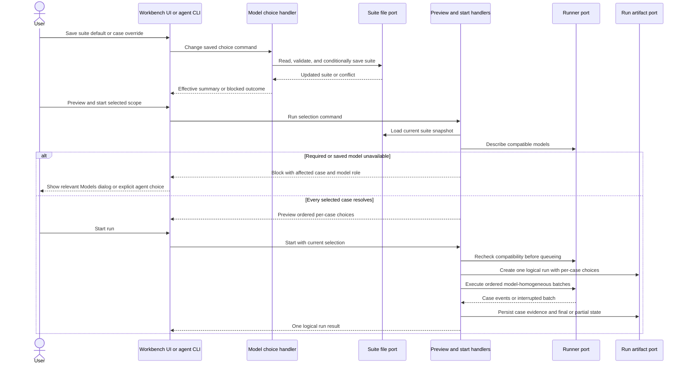

# Software Design: Eval Model Defaults

## Inputs and Design Scope

- Business source: `docs/features/eval-model-defaults/brd.md` (REQ-01–REQ-06; AC-01–AC-06).
- Binding UI goals: `docs/features/eval-model-defaults/ux.md`, including the phone, tablet, desktop, dialog, blocked, and case-first result mockups.
- Architecture: `docs/architecture.md` and the selected `command-pattern` guidance. This design remains within the existing **Local Evals Workbench** deep module; Template Catalog distributes any revised eval-authoring or agent-guided skill guidance, without owning project-specific choices.

The workbench currently accepts one tested model and one judge model for an entire run, and its runner protocol accepts one model pair per execute request. This feature makes model selection per case within one logical suite run, without changing the project runner protocol or adding a deep module.

## Responsibilities and Contracts

**Local Evals Workbench** owns the extended project-owned suite convention, saved-choice mutation, effective-selection resolution, preview/start consistency, runner orchestration, and per-case result evidence. The browser UI and agent-facing CLI are driving adapters over the same module operations. Neither surface calculates inheritance or silently substitutes a model. Provider availability comes from the runner's advertised compatible model lists, not from Sibu's sub-agent model-route catalog. These are different model-choice domains.

The feature needs focused command slices within this module:

- **Change saved model choice:** a command identifies one suite, optional case, model role, and set/reset intent. Its handler validates the current suite, chosen role and compatibility, applies only that choice through a project-file port, and returns the new effective summary or a precise blocked/conflict result. A reset suite default means absent; a reset case override means inherit. No other suite content is intentionally rewritten. (REQ-01, REQ-02)
- **Resolve run selection:** preview and start use one shared domain resolver against the same loaded suite snapshot and runner description. The resolver returns an ordered per-case selection of tested model and nullable judge model, or a blocked reason naming the affected suite/case and role. Full-suite scope rejects run-only model input; single-case scope may apply an explicit run-only choice after saved defaults are checked. (REQ-03–REQ-05)
- **Execute logical run:** the start handler records the resolved selections before scheduling execution. The execution handler accepts that immutable plan, persists one logical run, dispatches model-homogeneous batches to the runner, and emits one coherent result stream. (REQ-03, REQ-06)

Commands express intent, handlers enforce these policies, and result contracts use domain outcomes such as `missing-suite-default`, `saved-model-unavailable`, `invalid-override`, `suite-changed`, and `queued`. Ports cover suite read/write, runner description/execution, artifact storage, scheduling, and safe logging. HTTP/CLI entrypoints only parse requests and translate results; adapters own filesystem and runner protocol mechanics. Existing preview, start, execute, discovery, run-history, and workbench presentation slices must collaborate through their module-owned public contracts rather than importing one another's internals.

## Project-Owned Suite Format and Persistence

Extend the existing version-2 `evals/<suite>.json` convention with optional, separate suite defaults for the tested and judge model and optional corresponding fields on each test case. Absence represents an unset suite default or an inherited test-case choice; an empty string is invalid. Existing suites without these fields remain discoverable and valid, but execution stops for a required missing default. A case override is not an independent fallback when its suite default is unset: the suite default must still be chosen before any run. Judge choices are required only for selected rubric cases. The suite's `version: 2` and existing runner protocol remain unchanged; update strict suite validation and distributed authoring guidance to recognize these optional fields. (REQ-01, REQ-02, REQ-05)

Saving from **Suite models** or **Test-case models** changes the project-owned suite definition, not `.sibu/state.json` and not an ignored run artifact. The mutation port must confine writes to an existing suite definition directly under the project-root `evals/`, reject unsafe or symlink-escaping paths, re-read and validate the complete suite before writing, and use a compare-before-write token so concurrent manual edits are not lost. Apply an atomic replacement where supported; on conflict or write failure, leave the prior file intact and return a non-success outcome. Never store credentials or provider responses in suite definitions. (REQ-01, REQ-02, REQ-05)

Saved model IDs may become unavailable after a suite was last edited. Discovery should still show the suite and its saved choice; availability is checked at selection/save and again at preview/start against the current runner description. An unavailable suite default blocks for explicit replacement. An unavailable case override blocks for replacement or explicit reset to inheritance. Preflight every selected case before scheduling any paid runner call, so an unavailability discovered late cannot silently skip cases. (REQ-05)

## Main Flow and Runner Coordination

The run plan preserves source case order. Consecutive cases with the same tested/judge pair may share one runner request; a change in either model starts a new batch. The runner's existing one-pair-per-request protocol stays intact. An orchestration adapter translates batch boundaries into one logical event stream and one run ID; it must not expose an intermediate batch completion as the full run's completion. Stop on runner interruption or malformed events, retain completed-case evidence, and mark remaining cases honestly incomplete/partial. Do not retry paid calls automatically. (REQ-03, REQ-06)

The preview presents the ordered per-case model choices without call-count or price estimates. Model-choice controls likewise show model labels without price estimates. Start re-loads and re-resolves the suite immediately before queueing, so a changed file or model catalog cannot make a stale preview authoritative. If it differs materially, return an updated preview/blocked outcome and require a new user start decision rather than charging against unseen choices. A single-case **This run only** choice is carried on that start request but never saved. (REQ-03–REQ-05)

## Run Evidence, Presentation, and Compatibility

Persist the actual tested and nullable judge model per case in the run manifest/evidence and expose it through result-read contracts. New run-history data must distinguish per-case selections; retain read compatibility for existing single-model historical runs by interpreting their recorded run-wide pair as each historical case's pair. Do not rewrite or delete old run artifacts merely to add this feature. A result must not be labeled with the suite's *current* default if that default changed after the run. (REQ-06)

The UI follows the binding UX mockups: labeled **Models** actions, contextual persistent-choice dialogs, single-case-only **This run only** controls, automatic relevant dialog opening on a blocked **Start run**, and case-first result rows/cards with actual model labels. There is no always-visible case list and no model-column result matrix. The agent-guided flow uses the same resolver and blocking outcomes and updates its distributed guidance so it no longer demands a run-wide model selection for every run. (REQ-01–REQ-06)

## Security, Failure, and Operational Behavior

- Reject untrusted suite paths, malformed or oversized JSON, unsafe model IDs, invalid case IDs, and stale write tokens before mutation. Preserve the rest of a suite when one choice changes. Project file edits require the explicit **Save** action; viewing, previewing, running, and choosing **This run only** do not edit it.
- Missing and unavailable selections are expected blocked outcomes with a precise role and scope; filesystem failures, runner protocol failures, and partial execution are distinct. No automatic fallback, silent case skip, or automatic run restart after a dialog save. (REQ-05)
- Use safe structured events for choice saved/blocked, run queued/blocked, and partial/completed outcomes. Include stable suite/case identifiers and reason codes where safe; exclude credentials, prompts, rubric content, and raw model output from operational logs. Cost and provider calls remain external and uncertain.

## Quality Strategy and Planned Verification

This is a **plan**, not a claim that checks have run. The agreed verification excludes headless-browser UI tests, automated visual/accessibility review, and agent-performed visual review. Deterministic Node tests of UI markup, presentation data, and interactions with fakes are allowed; they do not launch the app in a browser or replace the user's later QA against the binding UX mockups.

- **Pure and fake-port tests:** cover independent tested/judge inheritance, per-case overrides, both reset meanings, single-case run-only choices that never persist, full-suite use of per-case choices, missing defaults even when a case has an override, compatibility changes, and no silent fallback. Assert typed blocked results and unchanged files on cancellation/conflict. Evidence: deterministic pass/fail tests for REQ-01–REQ-05 and AC-01–AC-05.
- **Suite-format and mutation tests:** validate old version-2 suites without new fields, strict rejection of malformed fields, explicit persistence of a single changed choice, symlink/root escape refusal, and concurrent-edit conflict without lost updates. Evidence: disposable project-file fixtures and unchanged unrelated suite content for REQ-01, REQ-02, REQ-05.
- **Runner/artifact integration with fakes:** exercise one logical full-suite run with eight cases on X and one on Y, independently varied judge models, ordered batches, preview/start recheck, and actual per-case model labels in persisted evidence. Inject interruption after completed cases and prove partial evidence is retained and old run history remains readable. Evidence: isolated fixture artifacts; no live LLM. Covers REQ-03, REQ-05, REQ-06 and AC-03, AC-05, AC-06.
- **Regression and packaged-runtime checks:** preserve existing deterministic preview, result inspection, repair, and UI contract behavior through focused Node tests during implementation; assert that preview and model-choice markup omit call-count and price estimates; check that distributed eval-authoring/agent-guided guidance and installed-package assets include the extended convention. After changes stabilize, run `pnpm verify` (which builds and runs the deterministic Node suite, including UI markup/fake-interaction tests) when Sibu templates change, then `pnpm run validate:packed-runtime`. Do not run a separate build or duplicate focused tests merely to repeat checks covered by `pnpm verify`. These commands have not been run for this document.
- **User-owned QA:** after implementation, the user compares suite and selected-case controls, both model dialogs, missing/unavailable states, **This run only**, and case-first results at phone, tablet, and desktop sizes with `docs/features/eval-model-defaults/ux.md`. The user judges visual fidelity, clarity, keyboard/screen-reader usability, and practical workflow fit. This SDD does not prescribe or claim automated UI review.

## Risks and Tradeoffs

- Mixed-model suites require multiple runner requests under one logical run. This adds orchestration and partial-failure handling but avoids changing the project runner protocol or falsely applying one model to all cases.
- Version-2 suite fields are optional for backward discovery, but a run cannot proceed without required user-selected defaults. This is a deliberate first-run setup stop, not a migration that invents model choices.
- New per-case run evidence needs backward reading of existing artifacts. Preserve old results rather than rewriting persisted history.
- The absence of headless-browser and automated visual/accessibility checks is a user-chosen verification constraint; visual and accessibility defects may remain until user QA.

## Mermaid Validation

The exact sequence block above parsed successfully with local Mermaid 11.12.0 (`mermaid.parse`, one diagram). Browser rendering was not run. Semantic review checked declared participants, ordering, existing module boundaries, the missing/unavailable branch, and partial-run evidence; parser acceptance alone does not prove rendering or behavior.
