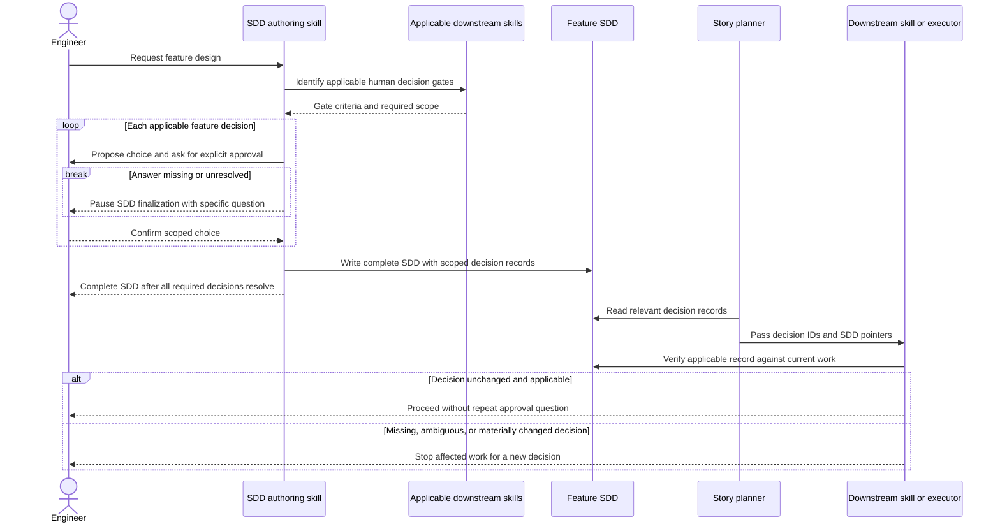

# Upfront Feature Decision Handoff — Software Design

## Inputs and scope

This design implements `docs/features/feature-decision-handoff/brd.md` (REQ-01–REQ-07). It follows `docs/architecture.md` and the selected `.agents/skills/command-pattern/SKILL.md`. The feature changes Sibu's prompt-owned SDD authoring and downstream skill guidance, not the CLI runtime. It has no UI impact, so no UX spec is required.

The governing behavior is narrow: identify human decisions that are already foreseeable for a planned feature, obtain each explicit scoped answer during the existing SDD interview, and reuse the unchanged answer at the downstream gate. No decision record grants general execution permission.

## Ownership and boundaries

- **SDD authoring guidance:** owns applicable-gate discovery, the feature-design conversation, and the self-contained decision records in the SDD. It checks the feature BRD, intended work, and applicable downstream skills rather than asking a universal questionnaire. It may use an applicable skill's decision criteria—for example, eval-authoring's target and risk-based coverage criteria—without creating that skill's output artifacts during SDD authoring. This covers REQ-01–REQ-04.
- **Implementation planning and execution guidance:** carries relevant decision IDs and SDD pointers into a Story plan and fresh Task context, then checks the authoritative SDD before relying on an approval. A packet summary is navigation, not approval evidence. The owning downstream skill consumes only a decision that matches its gate and current scope; missing, ambiguous, or materially changed choices stop the affected work. This covers REQ-05–REQ-06.
- **Eval-authoring guidance:** for eval work inside a planned feature, accepts SDD-recorded confirmation of Evaluation Targets and the approved Eval Coverage Plan when the target, scenarios, grading approach, tool behavior, gaps, and scope still match. Independent eval authoring without an applicable feature SDD keeps its existing target-confirmation and coverage-approval questions. Approval of targets alone never authorizes writing eval artifacts. This covers REQ-05.
- **Template Catalog:** distributes changed skill text and user-facing sync notes through its existing versioned manifest. Project-owned customized installed skills remain protected by `sibu sync`; this design does not alter them or create a separate approval store.
- **Operational boundaries:** Git base/target, model routes, credentials, external mutations, destructive actions, new material decisions, and final human Epic PR review retain their existing gates. A Feature Decision does not authorize these effects. This covers REQ-07.

The selected command-pattern guidance governs executable operations, but this feature adds no runtime operation. Do not manufacture a Command/Handler/Port layer for skill text or introduce a new deep module. If implementation discovers that a runtime approval service is necessary, return to the SAD rather than designing it implicitly here.

## Feature Decision record and reuse contract

The SDD has one easy-to-find **Feature Decisions** section. When no feature-specific gates apply, say so explicitly; do not generate empty approval fields. For each applicable gate, record a stable local decision ID, the governing downstream skill/gate, the exact human-approved choice, its scope, and the human confirmation in self-contained words. For eval coverage, include the confirmed target(s), intended scenarios and risk categories, grading and tool-behavior choices, and known gaps or exclusions. A generic “SDD approved” statement, an unanswered proposal, or an agent-inferred choice is not a decision record. The SDD itself has no overall approval status, signature, or sign-off ceremony (REQ-02–REQ-04).

The approved choice and scope form one decision-specific contract. Downstream guidance compares the current work and applicable gate to that record; it does not ask again when both still match. An unrelated prose edit elsewhere in the SDD does not invalidate the decision. If the choice or scope changes materially, or a required detail is absent, only the affected gate returns for an explicit human answer and a revised SDD record before that work continues. Do not infer renewed approval from an edited record alone. Existing plan-review rules still apply to any changed reviewable Story-plan content (REQ-05–REQ-06).

The record is project-owned design context, not a cryptographic attestation or new Sibu state entry. It provides a durable, inspectable statement for later fresh-context agents; it does not independently prove the human's original conversation. Sibu must not claim that static text checks establish actual agent compliance.

## Main flow and failure paths

The diagram shows conversational handoff, not a new runtime service or automatic external write. A newly discovered gate after SDD completion is not silently grandfathered into an earlier approval; its owning workflow stops and routes the decision back through SDD discovery. Ordinary implementation failures and operational authorization remain governed by their existing rules (REQ-04–REQ-07).

## Quality strategy and planned verification

The engineer confirmed this verification direction before SDD authoring. These are planned checks, not claims that implementation or validation has already run.

- **Deterministic guidance contracts (REQ-01–REQ-07):** static tests inspect the SDD-authoring, planner, executor, and eval-authoring guidance for conditional gate discovery, explicit scoped records, no SDD-wide sign-off, reuse without a repeat prompt, independent-eval behavior, material-change reapproval, and preserved operational/final-review gates. Use synthetic decision examples for an eval-containing feature, a feature without eval work, an unanswered gate, an unchanged decision after unrelated prose edits, and a materially changed decision. Passing assertions show prompt-contract consistency, not live-agent behavior.
- **Template lifecycle and distribution (REQ-03, REQ-05, REQ-07):** existing disposable-project lifecycle tests should verify changed templates and manifest notes are distributed and that init/sync protects customized installed skills. Do not run `sibu sync` on this repository as a validation shortcut. After changes stabilize, run `pnpm verify`; because packaged skill assets change, also run `pnpm run validate:packed-runtime`. Record actual commands and results during implementation, not in this design.
- **Edges and exclusions (REQ-04, REQ-06, REQ-07):** deterministic cases should require a stop for a missing or changed decision while leaving unrelated approvals usable, and should reject use of a Feature Decision as authorization for an operational action or final Epic merge. No live-model or agent eval is planned. No separate human-judgment check is part of this SDD; the engineer's later review is not marked performed by these tests.

Unit and lifecycle tests remain self-contained and do not call a live model. They cannot prove that a future agent will follow the guidance, so success claims must stay limited to the tested contract and observed artifact behavior. If implementation finds a required scenario that these checks cannot cover, surface the verification gap for an engineer-directed SDD revision instead of silently weakening the method.

## Risks and tradeoffs

- Gate discovery is bounded by the feature scope and applicable installed guidance at SDD authoring time. A newly introduced skill gate or genuinely new requirement can still require a later human stop; the feature reduces foreseeable interruptions, not every interruption.
- A self-contained SDD record is easy for fresh agents to use but is not independent proof of human provenance. Clear scoped wording and a missing/changed-decision stop protect against overbroad reuse; no new approval ledger is justified for this prompt-owned workflow.
- Cross-skill wording can drift when one template changes without its handoff guidance. Versioned template notes and focused lifecycle tests must keep the SDD writer and downstream consumers aligned while respecting customized installations.

## Diagram validation

The exact sequence block parsed successfully with locally installed Mermaid 11.12.0 (`mermaid.parse`); rendering was not run. Semantic review found the intended order and boundaries: unresolved required input prevents SDD finalization, unchanged scoped decisions pass to downstream work, and missing or changed decisions stop that work. Parsing does not establish live-agent behavior or the accuracy of a human approval.
