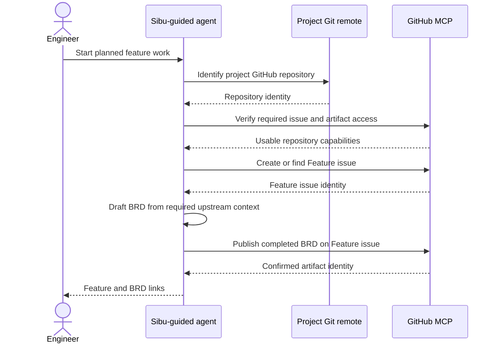
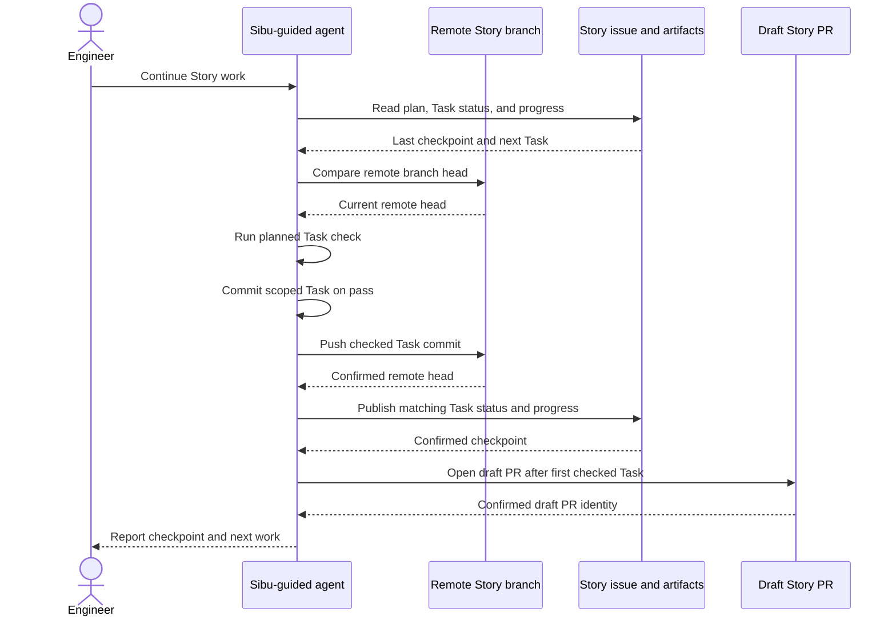

# Software Design: GitHub Feature Work Tracking

## Inputs and Scope

- Business source: `docs/features/github-feature-work-tracking/brd.md` (REQ-01–REQ-10, AC-01–AC-07).
- Binding CLI and agent-message states: `docs/features/github-feature-work-tracking/ux.md`.
- System boundaries: `docs/architecture.md`; selected architecture guidance: `.agents/skills/command-pattern/SKILL.md`.

Planned feature work uses the project's GitHub repository as its only authority for Feature, Epic, Story, plan, and progress artifacts. Project-wide Product Vision, Business Domain Model, Capabilities Map, and SAD remain repo-local. `sibu init`, `doctor`, `sync`, and narrow fixes do not depend on GitHub. There is no tracking-mode state, switch command, local feature-artifact fallback, migration, or backfill. This covers BRD REQ-01–REQ-03 without turning the Sibu CLI into a GitHub delivery engine.

## Ownership and Boundaries

The existing SAD boundaries are sufficient; no new Deep Module is needed.

| Owner | Feature responsibility and outside promise | Exclusions |
| --- | --- | --- |
| `agent-tool-configuration` | Continue rendering credential-safe GitHub MCP configuration when selected during local setup or configured later. | Rendering does not prove authentication, repository identity, or required issue-artifact capabilities. It does not call GitHub. |
| `workflow-installer`, `workflow-health-inspector`, and `sync-review-orchestrator` | Keep local adoption, read-only health inspection, and maintenance independent of GitHub availability. Installer and sync distribute changed guidance through Sibu's existing template lifecycle; health inspection remains read-only. | Do not add a feature-tracking choice, GitHub readiness probe, or migration to these workflows. |
| Prompt-owned pipeline and skill guidance | Gate planned feature work before its first artifact; read and publish authoritative GitHub issues/artifacts; coordinate checked Task checkpoints, draft Story PRs, safe resumption, and verified issue closure. | External agents use GitHub MCP and existing Git/PR host access under their operational permissions. The CLI does not own feature-delivery state or execute these remote operations. |

The selected command-pattern architecture applies to any executable CLI changes needed to distribute or configure guidance: a focused command/handler/result with slice-owned ports, thin entrypoints, and edge adapters. The feature's remote workflow remains in the SAD's prompt-owned pipeline, not a new handler or Deep Module. Template edits follow Sibu manifest-version, sync-note, and lifecycle rules. No existing-user compatibility behavior is required.

## Main Execution Flows

### Start and publish a feature stage (BRD REQ-01–REQ-03, REQ-09)

Before the first feature artifact, the agent establishes that the project has a GitHub repository remote and that GitHub MCP can access that same repository's issues, native sub-issues, and issue artifacts. A missing remote and an unavailable MCP capability are distinct blocked results with the specific next actions in the binding UX mockups. The agent creates no local substitute. Successful readiness does not grant mutation permission; normal host permissions still apply.

The Feature issue is the stable parent and index. BRD, UX, and SDD stages read only the published prerequisites they need through MCP into session context, then publish their own artifact at stage completion. Epic definitions become native sub-issues of the Feature; Story definitions become native sub-issues of their Epic. A Story's accepted implementation plan and concise progress are issue artifacts; its compact Task checklist remains in the Story issue. Do not write duplicate local Epic, Story, plan, or progress files or an on-disk feature-artifact cache. An interrupted, unpublished draft may need to be redone.

Before a create or update, identify the intended repository, issue, and artifact. On an uncertain response, read back the target before retrying to avoid duplicates or false completion. Missing or conflicting authoritative content blocks dependent stages. Issue-artifact version-history behavior is not required. This implements BRD REQ-02, REQ-03, and REQ-09.

### Publish a checked Task handoff (BRD REQ-04–REQ-07)

The Story branch starts from the current Epic branch. A Task is shareable only when its prescribed check passed, its scoped commit is pushed, and the Story checklist/progress artifact records matching completion, check evidence, commit reference, and next-work context. The draft Story PR targets the Epic branch and opens after the first checked Task is pushed, even for a one-Task Story; it may then move promptly to ready after the final checks. Later Tasks update the same branch and PR without a routine human continuation prompt. If PR creation or any publication step fails, report confirmed effects and stop rather than showing the handoff success mockup.

The branch push and issue update are separate effects. Clear matching responses can establish a checkpoint; ambiguous, timed-out, or conflicting effects require remote readback before the agent claims success or advances. Do not blindly repeat a create, force-push, or assume that a local commit is a cross-machine handoff. This implements BRD REQ-04 and REQ-05.

At session start and before publishing a Task, compare the authoritative Story issue/artifacts, draft PR if present, and current remote branch. An incomplete Task is available to another engineer from the last verified remote checkpoint without an ownership claim. If that Task was completed elsewhere, discard only local edits confidently attributable to the superseded Task, preserve unrelated or ambiguous edits, reconcile the branch and workflow state, and choose the actual next Task, Story, or Epic review. A concurrent push rejection, issue/branch mismatch, unknown edit ownership, or unsafe worktree stops for reconciliation. No broad reset, automatic stash, or silent overwrite is authorized. This implements BRD REQ-06 and REQ-07.

### Complete Stories, Epics, and Feature (BRD REQ-08, REQ-10)

After final Story checks and `Done when` evidence pass, the main agent verifies the exact draft PR identity, head/base, required checks, merge policy, and branch/worktree safety. It makes the PR ready and squash-merges into the observed Epic branch without routine human Story review. The next Story starts only from the updated Epic head. Close the Story issue only after its PR merge is verified.

After all planned Stories and the named Epic-level check pass, present one Epic PR for human review with links to every merged Story PR and actual verification evidence. The human owns Epic acceptance and merge. Close the Epic issue only after that PR merge is verified; close the Feature issue only after every Epic PR merge is verified. Native PR-to-issue linking and GitHub auto-close keywords are not prerequisites. Ambiguous merge or closure responses require readback; they are not completion. This implements BRD REQ-08 and preserves REQ-10's human gate.

## State, Safety, and Operational Visibility

- **Authority:** GitHub issue bodies and issue artifacts are the source of truth for planned feature documents and progress; project-wide documents remain local. Agent session context is transient, not a persisted feature cache.
- **Exact plan review:** the architecture reviewer examines the exact Story plan artifact content proposed for execution. Record a stable content fingerprint with review evidence; changed content requires fresh review before a Task starts. Artifact version-history UI is not assumed.
- **Acceptance criteria:** Story and Epic issue definitions carry settled scope. Progress publication updates Task status and evidence, not acceptance criteria without the existing human decision and replanning gates.
- **External effects:** Git push, issue/artifact publication, draft PR creation, merge, and issue closure are distinct. Report confirmed and uncertain effects separately, read back ambiguous outcomes, and do not advance from inconsistent remote state.
- **Least privilege:** GitHub MCP and Git/PR host permissions are checked at the action boundary. A configured tool is not proof of usable access. Do not log credentials, full private artifacts, or agent prompts.
- **Visibility:** operational logs may include safe operation names, issue/PR identifiers, commit IDs, outcomes, and failure categories. User-facing status follows the binding UX mockups rather than raw diagnostics.

## Feature Decisions

No additional feature-specific downstream human gate was identified for this SDD. The feature has no planned eval-authoring scope; a downstream planner may still surface a flag decision if a Story cannot otherwise be independently deployable. GitHub mutation permission, model-route selection, destructive-action safeguards, code-change approval where required, and final human Epic PR review remain separate operational or later-stage gates. This section grants none of them.

## Quality Strategy and Planned Evidence

This is the engineer-confirmed **planned** verification approach, not a report of implementation checks already run. It deliberately uses deterministic tests and fake external responses, not a disposable-repository integration check or separate QA gate.

| Coverage | Planned method and expected evidence |
| --- | --- |
| Readiness and local independence (BRD REQ-01) | Deterministic guidance/entrypoint checks for distinct missing-remote and missing-MCP stops before any feature artifact, no local fallback, and unchanged availability of `init`, `doctor`, `sync`, and narrow fixes. |
| GitHub hierarchy and stage publication (BRD REQ-02, REQ-03, REQ-09) | Fake-MCP contract scenarios for Feature/Epic/Story hierarchy, native sub-issue capability, BRD/UX/SDD stage checkpoints, selective prerequisite reads, no on-disk cache, missing artifact, timeout readback, and duplicate prevention. Static prompt checks show the contract is stated, not that a live agent follows it. |
| Checked Task and concurrent resumption (BRD REQ-04–REQ-07) | Deterministic fake-Git/MCP scenarios for check-before-commit, pushed hash matching Story progress, partial push/update failure, first-Task draft PR, changed plan fingerprint, concurrent remote advance, attributable superseded edits, protected unrelated edits, and ambiguous state stopping. |
| PR and issue lifecycle (BRD REQ-08, REQ-10) | Fake-host scenarios for draft-to-ready Story PR, verified squash merge before Story closure, human Epic merge before Epic closure, all Epic merges before Feature closure, and no native PR-to-issue-link dependency. |
| Terminal and agent messages (BRD REQ-01, REQ-03–REQ-09) | Output assertions for compact, medium, and wide states in `ux.md`, including the two distinct readiness blockers, unconfirmed publication, superseded work, and routine continuation without a new prompt. A person compares the affected terminal states with the binding mockups during the existing final Epic PR review; automation cannot establish subjective visual fidelity. |

After implementation stabilizes, run the repository's `pnpm verify` check and the applicable deterministic template-manifest/sync lifecycle checks. These are planned commands, not observed results. A person still owns the final Epic PR judgment, including whether terminal output matches the UX mockups; this does not add a separate human QA hold. No live-model eval, live GitHub test, disposable GitHub/repository integration run, or manual two-engineer rehearsal is required. Therefore deterministic tests cannot prove actual MCP behavior, GitHub semantics, agent compliance, or the cross-machine success scenario in a live repository. Runtime capability checks, readback, and honest stop states reduce but do not erase that evidence gap.

## Risks and Tradeoffs

- GitHub issue artifacts are an external preview capability; missing or changed support stops the affected feature action rather than shifting authority to local files.
- No on-disk cache avoids drift and accidental commits but adds remote reads at session boundaries. Selective reads reduce latency; interrupted unpublished drafts may be lost.
- Task-level handoff requires a remote checkpoint after each checked Task. Git and issue updates are not atomic, so partial-effect reconciliation is essential.
- Early draft Story PRs improve visibility and early checks but add an external effect before Story completion; they do not relax check or merge gates.
- Without live integration or behavioral QA, the SDD does not claim the cross-machine scenario has been demonstrated. Keep that limit visible at final Epic review.

## Diagram Validation

Both final Mermaid blocks parsed successfully with locally installed Mermaid 11.12.0. Rendering was not run; parsing confirms syntax acceptance, not visual output or live behavior. Semantic review checked participant roles, remote-operation order, SAD boundaries, and the distinct blocked and partial-publication paths described in prose.
