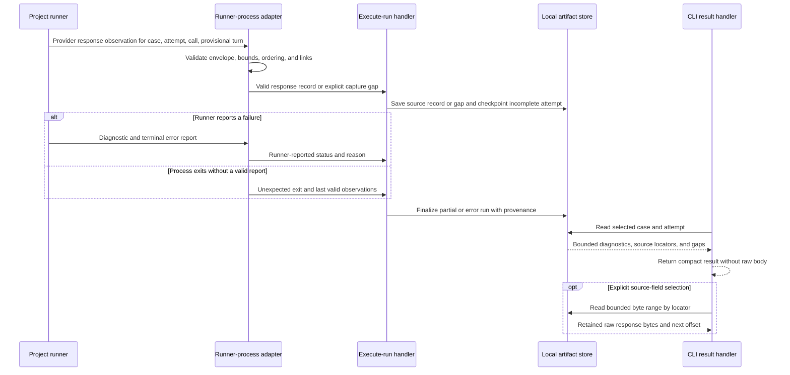

# Incomplete Eval Run Evidence Software Design Document

## Design basis and scope

This design implements `docs/features/incomplete-eval-run-evidence/brd.md` (REQ-01–REQ-08) within the existing **Local Evals Workbench** deep module in `docs/architecture.md`. The selected architecture is `command-pattern` from `.sibu/state.json`: the existing execute-run and read-result commands remain the application operations; runner and artifact I/O remain adapters behind their ports. This is a CLI and local-artifact change, not a dashboard feature or a new deep module.

The decisive gap is that current protocol-v2 source records are linked to a completed turn and a declared check. A provider response received before turn completion cannot satisfy those links. Current result selection also requires an assertion ID, although an incomplete attempt may have none. The design extends those contracts rather than manufacturing a turn, assertion, or completed case.

## Execution and evidence boundaries

| Boundary | Responsibility and promise |
| --- | --- |
| Project runner → `runner-process` adapter | Emit a versioned, ordered observation for each provider response as soon as its bytes are available, before parsing or normalization can fail. Identify run, case, attempt, model call, and provisional turn where known. A provider/transport failure without a response emits a bounded reason and explicit `not-observed` gap. |
| `runner-process` validator → execute-run handler | Validate event identity, order, sizes, links, and terminal reporting. Permit a provisional turn/call identifier before `conversation-turn-completed`; do not reinterpret an observed response as a completed turn. Pass valid response evidence and gap events to the handler incrementally. |
| Execute-run handler → artifact store | Persist the response record before advancing dependent execution state. Persist attempt diagnostics and structured failure provenance at each checkpoint. On a storage failure, stop claiming complete capture and record the gap if safe persistence remains possible. |
| Artifact reader → headless result handler | Read one selected case/attempt without an assertion; return bounded diagnostics, provenance, source locators, and gaps. Existing assertion selection remains supported. Read raw evidence only by selected locator and bounded byte range. |
| CLI entrypoint | Translate `evals result` options into the read-result command and render its structured result. No evidence interpretation, filesystem reads, or storage policy lives in the CLI. |

The provider-response observation needs its own source-record form, or an equivalent versioned extension, because `model-call.rawText` and normalized output are not necessarily the raw provider body. It carries the exact observed response bytes within the retained limit, content type when known, byte length, capture completeness, and a stable call/turn correlation. It does not require an assertion ID or a completed turn. Existing v1/v2 runners remain readable; absence of this new evidence in their runs is `not-captured`, never retroactively reconstructed. The next protocol version should make the new event opt-in by version, not weaken v2 validation. These are Local Evals Workbench contract changes, not a system-wide module decision. (REQ-01, REQ-07)

## Main flow and failure branches

The adapter must retain both facts when a valid runner error report is followed by a nonzero exit: a runner-reported failure and the process exit. A nonzero exit alone is `unexpected-process-exit`; a timeout, protocol rejection, or Sibu storage failure keeps its own stage. No code string is promoted to a proven provider, adapter, or Sibu root cause. Preserve the last valid checkpoint on malformed trailing events or process death, and mark any unfinished chunk or unobserved call as a gap. (REQ-02, REQ-04, REQ-06)

## State, limits, and inspection

- Keep the run manifest as a compact index of case states and attempts. Add structured terminal provenance to the persisted run/attempt evidence rather than infer it later from `runner-exited` or diagnostic strings. Existing diagnostic codes remain bounded and case/attempt-linked; attach call/turn identifiers only when observed. (REQ-02, REQ-04)
- Store response bytes in the established Git-excluded local artifact area, separate from the compact manifest and routine logs. Validate project-root containment, Git exclusion, and artifact identity on write and read; never trust a runner-provided path. A newly captured record is not advertised as available until its durable write succeeds. (REQ-01, REQ-05)
- Use explicit per-response and per-run byte ceilings. When a response exceeds a ceiling, retain a bounded prefix with `truncated` status, original length or missing extent when known, and a source locator. If the runner cannot observe or emit bytes, or Sibu cannot persist them, record the distinct gap instead of treating a partial prefix as complete. A cap must not turn the whole run into an opaque protocol error merely because a response was large. (REQ-06)
- The unselected `evals result` response gives run/case counts, state, failure-origin summary, and ordered failed **or incomplete** attempt locators within its output budget. `--case` plus `--attempt` selects an incomplete attempt without `--assertion`; an assertion ID remains available for an actual assertion. A selected result lists a bounded set of safe diagnostic codes, stage/provenance, turn/call links, capture status, and source-field locators. A selected `--field` read returns only a capped byte range and next offset. This extends the current `headless-eval-result` command/result and reader port rather than adding a second inspection API. (REQ-03, REQ-05)
- Raw provider content is never included in ordinary logs, the unselected summary, or the selected attempt overview. It appears only in the explicitly selected source-field read. The artifact is local and Git-excluded, but may be sensitive; the agent must not upload or share it as a side effect of diagnosis. Provider-internal hidden reasoning unavailable to the runner is never claimed as captured. (REQ-05)

## Project-runner contract and GeniusCR dependency

A conforming project runner emits a response observation promptly for every model and judge provider call whose response it can access, including non-success HTTP responses and responses later judged malformed. It captures the body before parsing, includes enough stable identity to associate it with the attempt and provisional turn, and emits a bounded failure reason if the call or capture fails. It must distinguish **no response received**, **response received but not emitted**, and **response emitted but rejected or not persisted** where it can know the difference. It must not put a raw body in a diagnostic message or stderr. (REQ-01, REQ-07)

Read-only inspection indicates GeniusCR's `website-assistant-conversations` runner currently emits reason codes and terminal error events on this path but no provider-response source record. GeniusCR therefore needs a separate runner/adapter update to emit the new observation before its malformed-output branch exits. Sibu cannot recover the historical `approximate-price` response from the codes alone. This SDD does not authorize GeniusCR edits.

## Quality strategy — planned, not yet run

The settled verification approach is deterministic and uses fake runners, not live models or a separate QA phase. A human owns interpretation of uncertain evidence and approval of later code changes; neither is a routine manual QA gate.

- **Handler unit tests with fake ports:** preserve response-before-failure checkpoints, valid provenance, incomplete attempt selection, missing/capture-failed/truncated gaps, and the invariant that no absent turn, assertion, response, or completed case is invented. (REQ-01–REQ-06)
- **Protocol and artifact contract tests:** exercise version compatibility, provisional links, malformed/reordered/chunked events, non-success bodies, binary/UTF-8 byte boundaries, per-response and per-run limits, interrupted writes, safe paths, Git exclusion, and bounded field-range reads. Confirm an over-limit body is visibly partial rather than silently dropped. (REQ-01, REQ-02, REQ-05–REQ-07)
- **CLI acceptance tests with disposable fake runners:** cover assertion, provider, adapter, judge, malformed-output, runner-reported error, unexpected exit, timeout, incomplete attempt without assertion, and absent response. For the GeniusCR-shaped case, expect status `error`, `approximate-price` incomplete, linked turn/call diagnostics, a source locator only if emitted, and an explicit gap otherwise. For the full-run shape, expect two completed, one incomplete, and 14 not run. Confirm normal JSON stays bounded and contains no raw body. (REQ-03, REQ-04, REQ-08)
- **Regression and distribution:** run focused tests first, then `pnpm verify` and `pnpm run validate:packed-runtime` once changes stabilize. Inspect command/handler/port/adapter dependency direction and source-file size when implementation is in scope. These are planned commands, not checks performed for this document. (REQ-08)

No live-model eval, dashboard visual review, automated behavioral QA, or human QA is part of this feature's verification plan. Fake-runner tests prove Sibu's handling of emitted evidence, not that a project runner or provider will always emit it. A real project's missing response remains a reported gap until that runner is updated and separately exercised. (REQ-07, REQ-08)

## Risks and tradeoffs

Capturing every observed response increases local storage and may retain sensitive provider content; hard caps, selected reads, Git exclusion, and explicit gaps limit exposure and prevent false completeness, but Git exclusion is not an access-control mechanism. Extending the protocol before turn completion is necessary for malformed responses and introduces ordering/link-validation work. Keeping v1/v2 reads compatible avoids mislabeling older runs, while new evidence is only available from updated runners. (REQ-01, REQ-05–REQ-07)

## Diagram validation

The exact sequence block passed `mermaid.parse` with locally installed Mermaid 11.12.0. Rendering was not run. Semantic review confirms the diagram keeps the runner outside Sibu, persists evidence before result inspection, and distinguishes runner-reported failure from unexpected process exit.
