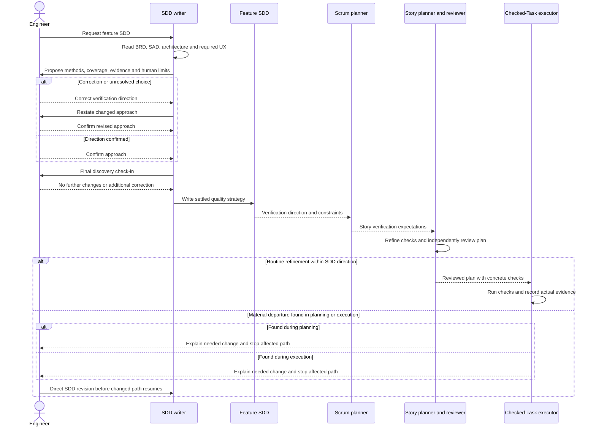

# User-Controlled Verification Planning — Software Design

## Purpose and source contract

This design implements the verification-direction handoff in [the feature BRD](brd.md) without making Sibu a workflow execution engine. All `REQ-*` references below refer to `docs/features/user-controlled-verification-planning/brd.md`. The project [SAD](../../architecture.md) identifies Skill Guidance and the AI-Augmented Development Pipeline as prompt/template-owned capabilities, not runtime deep modules. The selected [command-pattern guidance](../../../.agents/skills/command-pattern/SKILL.md) remains binding for any executable operations, but this feature adds none: no Command, Handler, Port, state store, or CLI entrypoint is justified for a conversational artifact workflow.

The engineer makes the **one routine human verification-strategy decision during SDD discovery**, before the SDD is written (`docs/features/user-controlled-verification-planning/brd.md` REQ-01, REQ-06). Existing independent Story-plan review and checked-Task execution remain; they are not new engineer approval points. A material departure is an exception that returns to the engineer through an SDD revision (`REQ-04`, `REQ-05`).

## Workflow design and ownership

The feature is delivered through Sibu-managed skill templates and their installed copies. The SDD is the authoritative feature-level verification direction; conversation establishes that direction but is not a signature, approval status, or durable second artifact (`REQ-01`, `REQ-02`).

| Boundary | Responsibility and handoff |
| --- | --- |
| `software-design-writer` | During discovery, synthesize a concise, feature-specific proposed verification approach from BRD, SAD, selected architecture, and required UX. Present it **before writing** and ask the engineer to confirm or correct it. Keep this distinct from the generic final “anything else?” check-in. Write the settled approach as an easy-to-find SDD quality strategy, with source requirement IDs, and do not mark it formally approved. |
| `scrum-master-planner` | Derive Story acceptance criteria, Verification Expectations, and likely Validation from the SDD approach. Preserve methods, coverage, evidence, human-judgment limits, and material exclusions, while slicing them by Story rather than copying the whole feature strategy into each Story. |
| `ai-implementation-planner` and planner toolbox | Refine the Story expectations into concrete, repository-appropriate Task checks and one final validation strategy. Select exact commands or equivalent checks within the SDD boundary without asking the engineer. Pass the governing verification context in the narrow worker packet. |
| Independent plan reviewer and execution gatekeeper | Compare the exact Story plan with the SDD direction and Story expectations. Treat an omitted required method, unsupported substitution, or hidden human-judgment need as a finding or material risk. Source-aligned, bounded corrections use the existing planner/review loop; they do not create a routine human plan-acceptance gate. |
| Checked-Task executor and main agent | Gather actual evidence for prescribed checks and `Done when` items. Report limits honestly. If implementation reveals an infeasible or insufficient confirmed approach, or a material new method, cost, external dependency, or human decision, stop affected work and request an engineer-directed SDD revision before planning or executing the changed path. |

The first four boundaries are guidance and artifact handoffs, not new runtime services or cross-module imports. Existing Story review, execution, commit, and Epic controls continue unchanged. For local implementation, update the source templates through Sibu's template-change process; installed managed copies are downstream distribution targets, not separate policy authorities. This preserves the SAD's Template Catalog and Sync Review Orchestrator ownership rather than adding a new Deep Module.

### Verification approach contract

The proposal and SDD quality strategy use concise prose or a small table, not a universal checklist. They answer, for this feature:

- **What and where:** relevant behavior, risks, scenarios, surfaces, states, and (for UI) breakpoints.
- **How:** suitable unit, acceptance/integration, edge/failure, regression, manual, or other justified methods; exact commands only when known.
- **Evidence:** what a reviewer should see, including pass/fail outputs, inspected artifacts, and any deferred human-only observation.
- **Human ownership and limits:** subjective judgments, external costs/dependencies, exclusions, and constraints that automated checks cannot settle.

For UI-changing features, the writer derives named screens, states, and breakpoints from binding UX mockups. The proposal and SDD distinguish **visual fidelity review** from functional tests and automated accessibility checks; they identify where a person must compare the implementation against the mockups (`REQ-03`). Automated checks may support that review but cannot be described as proving subjective visual quality. For non-UI features, no visual-review boilerplate is required.

The writer should ask focused follow-ups if a material part of the approach is unresolved, then present the complete proposal and receive confirmation or corrections. After corrections, it re-presents the changed approach if needed so the engineer can see the direction that will be written. The existing final conversational check-in remains a separate chance to raise other design concerns; it cannot substitute for the concrete proposal (`REQ-01`).

## Main interaction and exception flow

The diagram shows the human decision at SDD creation and the exceptional material-change loop. It does not replace existing plan-review and Task evidence gates. If the final check-in changes verification direction, the writer revises the proposal and confirms that changed direction before writing.

## Change classification and failure behavior

**Routine refinement** includes choosing an existing repo command, test fixture, equivalent local check, or more precise Task evidence that implements the confirmed methods and coverage without changing human ownership, cost, or external effects. The planner may do this unattended (`REQ-04`, `REQ-06`). A plan review may repair an incomplete plan within this boundary through the existing automatic revision and fresh-review loop.

**Material departure** includes dropping or substituting a required method so it no longer answers the same verification question; discovering uncovered scenarios or surfaces that change the strategy; introducing a new manual judgment point, live-model or external-service call, meaningful expense, new tooling/dependency, or a validation constraint that makes the confirmed approach infeasible. The agent states the difference, why it matters, what work is stopped, and the smallest decision needed. It does not silently change the SDD, plan, or Task check. The engineer chooses the direction; the writer then revises the SDD, and affected downstream work is re-derived and reviewed against the revised source (`REQ-05`). An unavailable command with an equivalent in-scope check is routine; an unavailable method with no equivalent is material.

Failures to identify the relevant SDD approach, contradictory source guidance, or missing UX coverage block a confident handoff rather than invite a guessed check. A failed prescribed Task check remains a failed check under existing executor recovery rules; it is not automatically a verification-strategy change. No new approval metadata or persistent workflow state is introduced.

## Quality strategy for this feature

This section is the confirmed direction for verifying the **verification-planning workflow itself**, not a claim that tests can prove model compliance. The engineer confirmed that review happens during SDD creation, not as a routine review of implementation plans, and that LLM behavior cannot be proven by tests. This is the direction downstream Stories should preserve (`REQ-01`–`REQ-06`).

| Coverage and method | Expected evidence and human limit |
| --- | --- |
| SDD discovery contract (`REQ-01`, `REQ-02`, `REQ-06`) | Deterministic prompt/template assertions inspect that a concrete proposal precedes SDD writing, asks for confirmation/correction, covers method/coverage/evidence/human limits/exclusions, and stays distinct from the final check-in. Review the guidance text for proportionate, non-formal language. Static assertions establish wording, not agent behavior. |
| UI branch (`REQ-03`) | Static contract and scenario review check that UI-changing features name UX-derived screens, states, and breakpoints and distinguish visual judgment from functional/accessibility automation. Non-UI scenarios should avoid irrelevant visual boilerplate. No subjective screenshot quality is claimed by automated tests. |
| Downstream preservation (`REQ-04`, `REQ-06`) | Inspect Scrum and planner handoff contracts and test representative deterministic fixtures for preservation of required methods/limits while permitting exact-command choices. Review the independent plan-review path for no added routine engineer approval. |
| Material-change stop (`REQ-05`) | Contract and focused fixture checks cover material substitution, unavailable method without equivalent, new external cost/dependency, and newly required human judgment; expected output is a stop and SDD-revision request. Separately cover routine equivalent-check selection and ordinary failed-check recovery to avoid false pauses. |
| Distribution/regression | Template manifest, update notes, and Sibu lifecycle validation show changed guidance is packaged and protected by `sibu sync` ownership rules. Run repository aggregate validation when implementation stabilizes; inspect the final diff for no unrelated runtime module or approval status. |

At implementation time, select the repository's actual focused tests and final aggregate check from its definitions; `pnpm verify` is the current build/type/test aggregate, and `pnpm run validate:packed-runtime` is relevant if changed templates affect package distribution. The template-change lifecycle checks must be selected from their actual definitions. These are **planned checks, not results run for this SDD**. Do not put a live LLM call in unit tests. A separate isolated agent eval could provide limited observed behavior if later explicitly requested, but is not required for this feature. Property/fuzz, mutation, and load testing add little confidence for this bounded prompt-contract change; manual semantic review is the important complement to deterministic checks.

## Risks and tradeoffs

- Prompt guidance can be ignored or interpreted inconsistently. Tests can catch missing contracts and handoff regressions but cannot guarantee any future agent follows them; actual Story evidence and human exception handling remain necessary.
- Overly broad “material change” wording could stop AFK delivery for routine command choices. The routine/material examples above keep the engineer decision at the strategy boundary, not every plan.
- Repeating the full approach in every downstream artifact would inflate context and invite drift. The SDD stays authoritative; Stories and plans carry only applicable expectations with source references.
- Extra review ceremony could turn the feature into SDD sign-off. The only planned routine conversation is the pre-writing proposal and existing final check-in, with no approval field or Story-by-Story human gate.

## Diagram validation

The sequence diagram's participants, order, branches, and stop path were checked against the BRD and SAD. The exact final block passed local Mermaid 11.12.0 parser validation. Rendering was not run; syntax acceptance does not establish rendering or model behavior.
